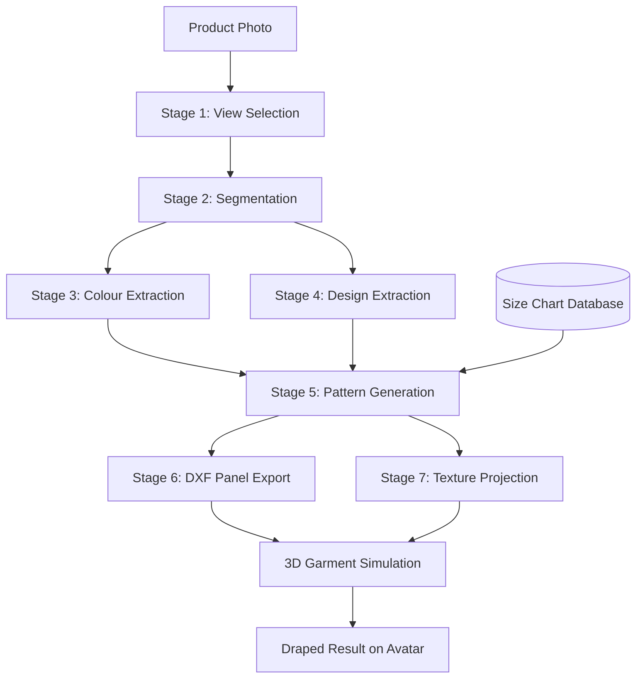
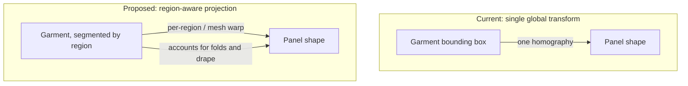

# Image-to-Panel Garment Reconstruction — Progress Report

*Status: current*
*Prepared: 2026-10-06*

## 1. Project summary

Online fashion retail only ever provides flat product photographs of a garment, but realistic 3D virtual try-on needs the garment built from actual flat **sewing panels** that can be draped over a body — the same way a garment is physically constructed from cut fabric pieces. This project builds and improves a computer vision pipeline that bridges that gap: given a product photo, it segments the garment, classifies the view, extracts its colour and surface design, and reconstructs the dimensioned flat panels needed to recreate it in 3D.

The pipeline described here is not a toy prototype — it is a real, working system, developed as part of a larger product (Mirra, a virtual try-on platform).

---

## 2. System overview

Two independent inputs meet only at Stage 5: the **photo** determines shape, colour and design, while a **size chart database** (real seller-provided measurements, e.g. chest width and garment length per size) determines actual physical dimensions. The photo is never asked to guess a garment's real-world size — that always comes from verified measurement data.

---

## 3. Technology used at each stage

| Stage | Technique | Why this technique |
|---|---|---|
| 1. View selection | **CLIP** (zero-shot image-text classification) | Classifies which photo shows which angle (front/back) and picks the one to process, before spending compute segmenting every candidate photo |
| 2. Segmentation | **SAM 2** (Meta, promptable segmentation), with **U²-Net** (via `rembg`) as a fallback | SAM 2 gives high-quality, promptable foreground/background separation at native resolution; U²-Net is a lighter, dependable fallback when SAM 2 is unavailable |
| 3. Colour extraction | **K-Means clustering in LAB colour space**, with HSV-based skin-tone exclusion and adaptive cluster count (silhouette score) | LAB space matches human colour perception better than RGB; excluding skin pixels before clustering stops a visible model's skin tone from polluting the garment's colour reading |
| 4. Design extraction | **Canny edge detection** with brightness-adaptive thresholds, a local-variance map for low-contrast logos, and an **FFT**-based detector for repeating all-over prints | A single fixed-threshold edge detector misses faint logos and repeating patterns; these three additions each target a specific documented failure mode |
| 5. Pattern generation | Parametric, geometry-driven panel construction, combining extracted shape with the real size-chart measurements | Deliberately **not** a learned model — panel dimensions must match a size chart exactly, which a deterministic calculation guarantees and a trained model cannot |
| 6. DXF export | `ezdxf`, following the apparel-industry DXF-AAMA convention | Industry-standard format for driving downstream 3D garment-simulation import; curve edges are encoded to preserve a strict one-to-one mapping with the seam-sewing manifest |
| 7. Texture projection | **Homography-based warping** (OpenCV) of the photographed garment onto each flat panel's shape | Lets the simulated 3D garment show the *actual* photographed fabric and print, not a flat placeholder colour |

---

## 4. Problems encountered

1. **Complex prints and patterns sometimes fail colour/design separation.** Heavily patterned or low-contrast garments are the hardest case for the current edge-detection-based design extraction.
2. **Very tight or very loose garment fits sometimes under-segment**, and unusual photo angles cause view misclassification.
3. **Single-image limitation.** The pipeline currently selects and processes only **one** photo per garment, even when more are available — meaning a back-of-garment design (e.g. a logo only printed on the back) is currently invisible to the whole system, and the back panel's shape is assumed rather than evidenced from a real photo.
4. **The core problem this project targets: texture projection uses a single global transform per panel.** The current implementation computes one homography (a flat geometric mapping) between the garment's photographed bounding box and each panel's shape. This works for a garment photographed perfectly flat, but fails to account for **drape, folds, and perspective distortion** in the original photo — exactly the gap this project's proposed contribution addresses.
5. **No fabric/material property estimation exists at all.** Every garment currently simulates with identical cloth physics (stiffness, weight, drape), regardless of what the actual material looks like in the photo — a confirmed gap, not yet in scope for this project but relevant to the wider system.
6. **Limited labelled dataset.** Only a small number of real garments have been fully processed so far, which constrains any approach that would require training or fine-tuning a custom model rather than using pretrained components.

---

## 5. Future plan

Replace the single global homography in texture projection with a **region-aware or mesh-based warping approach** that can account for fabric folds and perspective distortion within the photographed garment, rather than assuming a flat, linear mapping. This will be evaluated by direct visual comparison against the current single-homography output, on the same real product photos already processed by the system, and by observing the result once draped onto a measurement-accurate avatar.

**Broader future directions identified, beyond this project's immediate scope:**
- Extending the pipeline to accept multiple photos (front and back) per garment, so back-panel shape and back-only designs are reconstructed from real evidence instead of assumption.
- Applying pretrained fashion-specific segmentation models to improve design/logo extraction on complex prints, before considering any custom model training.
- Estimating approximate fabric/material properties from the photo, to drive more realistic simulated cloth physics per garment rather than one fixed default.
- Adding automated confidence scoring at each pipeline stage, so a low-confidence extraction can be flagged for review rather than silently used.

---