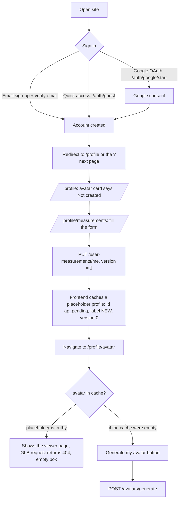
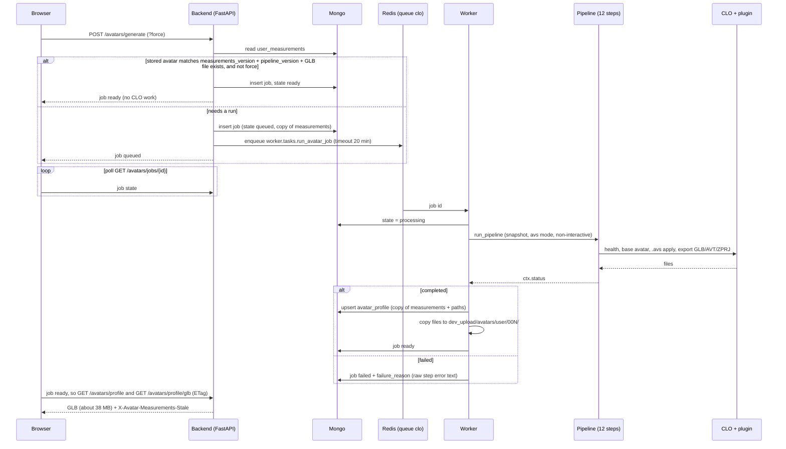
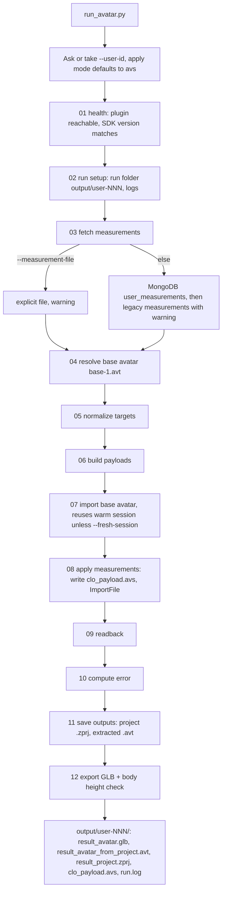

# 01 — Avatar generation workflow (new user, existing user, CLI vs website) and reference notes

*Status: current-state description, read from the code; nothing in it has been changed or run live*
*Compiled: 2026-10-18*

This is the reference file for the website clean-up. Any future reference or information goes here; problems go in `02-issues.md`. Diagrams use Mermaid (they render in VS Code's Markdown preview and on GitHub).

## 1. The parts involved

| Part | Where | Job |
|---|---|---|
| Frontend | `website/frontend/src` (React, TanStack Query) | Pages `/auth/*`, `/profile/measurements`, `/profile/avatar`, `/studio` |
| Backend API | `website/backend/src` (FastAPI, Mongo, Redis client) | Auth, `user_measurements`, `avatars`; queues the job |
| Redis | `docker compose up redis` | RQ queue named `clo` |
| Worker | `worker/run_worker.py`, `worker/tasks.py` (native Windows, `SimpleWorker`, concurrency 1) | Runs the pipeline, writes job/profile to Mongo, copies files to `dev_upload/` or `live_upload/` |
| Pipeline | `clo_avatar_generation/avatar_runtime/` (12 steps) | Drives CLO through the REST plugin at `localhost:50505` |
| CLO + plugin | CLO3D 2026.1.224 with the REST plugin started by hand | Builds the body, exports GLB / AVT / ZPRJ |
| Storage | Mongo collections `users`, `user_measurements`, `avatar_jobs`, `avatar_profiles`; files under `dev_upload/avatars/<user>/00N/` | |

## 2. New user (first time on the website)



Notes:
- Box `L` is what the code does today (see `02-issues.md`, B1). Box `M` is what the page was written to do.
- Nothing generates on page load; only the button does (comment in `ProfileAvatar.tsx`).

### 2.1 What happens after the Generate click (shared by new and existing users)



Job states in the backend: `queued`, `processing`, `ready`, `failed`. The progress screen shows the old five-stage list from the photo pipeline (see B2/B3).

## 3. Existing user

```mermaid
flowchart TD
    A[Sign in again] --> B[/profile]
    B --> C{avatar profile in Mongo?}
    C -->|no, measurements only| D[Same as new user from step J: /profile/avatar]
    C -->|yes| E[/profile/avatar: viewer loads GLB]
    E --> F{X-Avatar-Measurements-Stale}
    F -->|false| G[Use my saved avatar leads to /studio]
    F -->|true| H[Banner: measurements changed + Regenerate]
    F -->|unknown| G
    G --> S[/studio uses avatar for try-on/]
    H --> I[Confirm: Replace it]
    I --> J[POST /avatars/generate, runs the whole flow in 2.1]
    E --> K[Edit measurements on /profile/measurements]
    K --> L[PATCH /user-measurements/me, version + 1, no generation]
    L --> M[Back to /profile/avatar]
    M --> N[Stale only shows after a reload: B7]
    E --> R[Regenerate avatar button]
    R --> I
    E --> X[Delete avatar]
    X --> Y[DELETE /avatars/profile removes profile + jobs, measurements stay]
```

Notes:
- "Skip if fresh": if the user clicks Regenerate while the stored avatar already matches `measurements_version` and `pipeline_version`, the backend returns a ready job without touching CLO (`?force=true` overrides).
- Bumping `AVATAR_PIPELINE_VERSION` (currently `avs-1`) makes every older avatar count as needing a rerun.
- Avatar files are versioned per user: `dev_upload/avatars/<user>/001/`, `002/`, and so on; the profile points at the latest.

## 4. Terminal CLI generation

Command (repo root): `python clo_avatar_generation/run_avatar.py [--user-id u_001] [--non-interactive] [--measurement-file ...] [--fresh-session] [--base-avatar ...] [--run-number N]`



## 5. CLI versus website

| Aspect | Terminal CLI | Website (worker) |
|---|---|---|
| Start | You run `run_avatar.py` | User clicks Generate, backend queues in Redis, worker picks it up |
| Needs running | CLO + plugin | CLO + plugin + Redis + worker + backend + Mongo |
| Who is the user | `u_001`-style ids from the legacy `measurements` collection (or a file) | Real account id; data from `user_measurements` |
| Measurement source | Explicit file, else Mongo `user_measurements`, else legacy `measurements` (with a warning) | A copy taken when the job was created (`measurement_snapshot`); the worker passes it in, no new database read |
| Prompts | Interactive unless `--non-interactive`; missing values can be typed | Never interactive; missing values fail the run |
| Fields | All fields, field filters available | `enable_legacy_route=False`, no field filters |
| Skip if unchanged | No, always runs | Yes: reuses the stored avatar when measurement and pipeline versions match |
| Session | Warm session reuse, `--fresh-session` to force reset | Same pipeline code, so same reuse between jobs |
| Run folder | `clo_avatar_generation/output/<user>-NNN/` | Same folder (debug trail), plus a copy of the final files in `dev_upload/avatars/<user>/00N/` |
| Result record | Console output and JSON/log in the run folder | Mongo `avatar_jobs` + `avatar_profiles`; files in `dev_upload`/`live_upload` |
| Failure shown as | Full step log in the terminal | `failure_reason` string (`step_name: error`), shown on the website as-is |
| Timeout | None | RQ job timeout 20 minutes |
| Concurrency | One run per CLO | Worker concurrency 1; backend does not stop a second request for the same user |
| Height check | Step 12 fails the run if the GLB body was not resized | Same, since the worker uses the same step |
| Verified live | Yes (runs `u_001-092`, `u_003-005`) | Not yet in this form; only the pieces were tested with a fake database |

## 6. Where the data lives (current)

| Collection | Key fields today |
|---|---|
| `users` | account, consents, `is_guest` |
| `user_measurements` | one per user: gender, accuracy, units, the body fields, `body_shape_type`, `skin_tone_hex`, `measurements_version` |
| `avatar_jobs` | `user_id`, `measurement_snapshot` (full copy), `state`, `failure_reason`, `avatar_profile_id`, timestamps |
| `avatar_profiles` | one per user: `source_job_id`, gender, `measurements` (full copy), `body_shape_type`, `skin_tone_hex`, `source_measurements_version`, `pipeline_version`, `clo_avatar_avt_path` (absolute path on the worker machine), `avatar_glb_path`, `clo_run_id`, `generated_at`, timestamps |

## 7. Reference notes added later

*(add new reference information below, newest last)*

### 7.1 Field audit of the avatar data (2026-10-19, from grep of backend, frontend, worker and pipeline)

| Field | Where it is read | Verdict |
|---|---|---|
| `avatar_profiles.pipeline_version` | `avatars/service.py` skip-if-fresh check; set by `worker/tasks.py` | Requested for removal. Side effect: old-pipeline avatars then count as fresh when `measurements_version` matches |
| `avatar_profiles.body_shape_type`, `skin_tone_hex` (and the same two in `user_measurements`) | Copied into the profile and sent to the frontend schema; no page uses them; the form never sends them; the pipeline never reads them | Unused. `skin_tone_hex` may return with the planned face/skin work; `body_shape_type` has no use |
| `avatar_profiles.gender`, `measurements` | `measurements` feeds the measurements page today (see B30); `gender` unused by the UI | Duplicate of `user_measurements`; the page should read `/user-measurements/me` |
| `avatar_profiles.source_job_id` | Sent to the frontend as `sourceJobId`; nothing uses it | Unused |
| `avatar_profiles.generated_at` | Written by the worker; never read | Unused (`updated_at` exists) |
| `avatar_profiles.clo_avatar_avt_path` | `worker/tasks.py` try-on reads it | Used, but an absolute path; can be rebuilt from the version folder |
| `avatar_profiles.clo_run_id` | GLB ETag; try-on document | Used |
| `avatar_profiles.source_measurements_version` | Stale check | Used |
| `avatar_jobs.avatar_profile_id` | Mapped on the frontend; the avatar page never reads it | Unused by the UI |
| `avatar_jobs.measurement_snapshot` | Worker passes it to the pipeline | Used (could be replaced by a version number plus a read at job start) |
| `user_measurements.bust_circumference_cm`, `under_bust_circumference_cm` | No form field; pipeline only range-checks them; the `.avs` model does not use them | Unused |
| `user_measurements.weight_kg` | Form field and measurements page; range-checked in step 3; the `.avs` model does not use it | User data, not avatar input |
| `user_measurements.accuracy` | Sent by the form; nothing downstream reads it | Unused |
| `user_measurements.units_preference` | Display only (frontend) | Used for display |
| Inputs the `.avs` route really uses | `height_cm`, `chest_circumference_cm`, `waist_circumference_cm`, `hip_circumference_cm`, `leg_length_cm` (inseam), `shoulder_width_cm`, plus `gender` to choose the male template | Core |

### 7.2 What each user sees, avatar numbering, and history (2026-10-19, read from code)

**Measurements a user sees on `/profile/measurements` today**
- **New user:** no avatar profile exists, so the page shows the form. All seven fields start at defaults: height 175, weight 70, chest 96, waist 82, hips 98, shoulder 44, inseam 80, with gender male, accuracy "accurate" and metric units. Nothing is saved until the user presses Save.
- **User with an avatar:** the page shows the values stored in the avatar profile, which is the copy taken at the last generation. After an edit it can still show those old values (B30).
- **User with saved measurements but no avatar:** sees the empty default form again, not their saved values (B30).
- After the planned change, everyone sees the values in `user_measurements`, and the form (with defaults) appears only when none are saved.

**How avatar numbering works**
- Each generation makes a run folder in `clo_avatar_generation/output/<user_id>-NNN/` (per-user run number, 001, 002, ...).
- The worker then copies the result to `dev_upload/avatars/<user_id>/00N/` (or `live_upload` in production). `00N` is the highest existing folder number plus one, so versions only go up and never overwrite.
- A user has one `avatar_profiles` document (unique on `user_id`). Each successful run replaces it and sets `avatar_glb_path` to the newest version folder. The page and the Studio ask for `/avatars/profile/glb`, which serves whatever that path says: always the latest. Older folders stay on disk, unreferenced (B33).
- Version 002 for `u_dcabc592e2bb18e7` was built from run `u_dcabc592e2bb18e7-009`; the link is `clo_run_id` and `run_manifest.json` in the version folder.

**Old copies of a user's measurements**
- `user_measurements` keeps only the latest values plus the `measurements_version` counter. Old values are overwritten.
- Old values survive in three places: the `measurement_snapshot` in each `avatar_jobs` document (one per Generate click, until the avatar is deleted), the measurement JSON printed in each run's `run.log`, and the copy in the version folder's `run.log`.
- There is no table of measurement history, and the profile copy is replaced on each run.

**Where a user's GLB is stored and found**
- Stored in `avatar_profiles.avatar_glb_path` as a path relative to the upload root, for example `avatars/u_dcabc592e2bb18e7/002/avatar.glb`. It is never a URL and never an absolute path.
- The upload root comes from the backend setting `APP_ENV`: `dev_upload/` in development, `live_upload/` in production. The backend resolves root plus relative path, and refuses anything that escapes the root.
- The browser never sees the path. It calls `GET /avatars/profile/glb` with its bearer token; the backend looks up the caller's own profile and streams the file (ETag as `<clo_run_id>-<file size>`).

**Worker lifetime**
- `run_worker.py` starts an RQ `SimpleWorker` with no burst mode and no idle timeout, so it does not exit by design. In practice it can exit by itself after about 40 minutes idle, because Docker Desktop drops the idle Redis connection and RQ quits on the timeout (see `.agent/saumy/00-WORKER-REDIS-TIMEOUT.md`; not fixed yet, issue B38). It also does not start or close CLO. If CLO is closed or the plugin server is not started, the next job fails at the health step.

